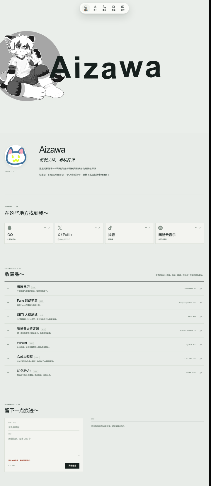

# aizawa的抹茶农场 · Aizawa 个人主页



单页个人主页：悬停标题字母时，字母换成对应单词、本人照片填进字形里，黑色聚光从该字母为圆心扩散铺满背景。原生 HTML / CSS / JavaScript，无框架、无依赖、无需构建。

基于开源模板 **Text → Image Letters** 改造，在原模板的字母交互之上加了导航、关于、联系、收藏和留言板。

## 页面结构

| 区块 | 说明 | 代码 |
| --- | --- | --- |
| `#top` 首页 | 字母标题 + 福瑞肖像 | `app.js` / `config.js` / `style.css` |
| `#about` 关于 | 头像与自我介绍 | `index.html` / `style.css` |
| `#contact` 联系 | QQ、X、抖音、网易云四个入口 | `index.html` / `style.css` |
| `#collection` 收藏 | 7 条常逛站点 | `collection.css` |
| `#guestbook` 留言 | 表单 + 留言列表 | `guestbook.js` / `guestbook.css` / `_serve.ps1` |

顶部导航（`nav.js` / `nav.css`）负责平滑滚动、当前区块高亮、下滑隐藏上滑出现，移动端断点在 760px 与 520px。

## 本地运行

任何静态服务器都可以：

```sh
python3 -m http.server 8000
```

浏览器访问 http://localhost:8000 。直接双击打开 `index.html` 也能看标题和滚动效果，只有留言板会因 `fetch` 受限而失败。

## 留言板需要一个后端

`guestbook.js` 读写 `/api/messages`，这个接口由仓库里的 `_serve.ps1` 提供——一个用 PowerShell `HttpListener` 写的本地小服务器（端口 8123），同时兼作静态文件服务器：

```powershell
pwsh ./_serve.ps1   # 或右键用 PowerShell 运行，然后访问 http://localhost:8123/
```

它的行为：留言存进同目录 `guestbook.json`（最多留 200 条、接口返回最近 50 条）、正文限 280 字、昵称限 24 字、同一 IP 5 秒内只能发一条，渲染全部走 `textContent` 不拼 HTML。`guestbook.json` 已在 `.gitignore` 里，属于运行时数据。

**这意味着纯静态托管（GitHub Pages / Netlify / Vercel / Cloudflare Pages）跑不了留言板**：接口 404 时页面会显示「留言暂时没有加载出来，稍后刷新试试」，其余功能不受影响。要让访客真能留言，需要把 `_serve.ps1` 的逻辑挪到某个有服务端的环境，或者换成第三方留言服务。

## 改配置

编辑 `config.js`：

```js
window.LETTER_CONFIG = {
  text: 'Aizawa',
  labels: ['Attentive', 'diligent', 'civilized', 'brave', 'aware', 'stamina'],
  imagesByPosition: [['00-A.jpg'], ['01-i.jpg'], ['02-z.jpg'], ['03-a.jpg'], ['04-w.jpg'], ['05-a.jpg']],
  enterDuration: 340,
  exitDuration: 620,
  backgroundVideo: ''
};
```

`imagesByPosition` 和 `labels` 都按**非空格字符位置**排列，当前是每个位置一张照片。悬停第 N 个字母时，标题换成 `labels[N]`，并用 `imagesByPosition[N][0]` 作为照片填充字形。素材放在 `assets/`。

`index.html` 改文案、标签和网页标题；`style.css` 改配色、布局和字间距；`nav.css` 里的 `scroll-margin-top` 需要和导航区块列表保持同步。

## 验证

```sh
node --check app.js && node --check nav.js && node --check guestbook.js
node scripts/validate.mjs
```

`validate.mjs` 会检查 `text` 的非空格字符数与 `imagesByPosition` 长度是否一致、每个引用的素材文件是否真的存在。

## 已知限制

- 没有站点图标，浏览器会请求 `/favicon.ico` 并拿到 404。
- 留言板依赖自建后端，静态托管下降级为提示文案（见上）。
- 标题排版按 6 个字符的短标题校准，换更长标题或别种语言需要同步调 `style.css` 里 `h1` 的字号；这不是组件库。
- 非 BMP 单字符通常能显示，组合 emoji 和复杂文字塑形未适配。
- 移动端只在 760px / 520px 断点做过桌面端窄窗验证，未在真机实测。

## 许可与来源

代码与所附素材按 [MIT License](LICENSE) 提供。上游模板为 Text → Image Letters（LICENSE 中保留了原作者的版权声明）。

`docs/MATERIALS.md` 与 `docs/materials.json` 记录的是上游模板自带的 22 张布艺字母示例的构思与完整提示词，那些素材文件已从本仓库移除（约 2.0 MB、且不再被任何代码引用），这两份文档仅作为模板的素材制作方法留档。
